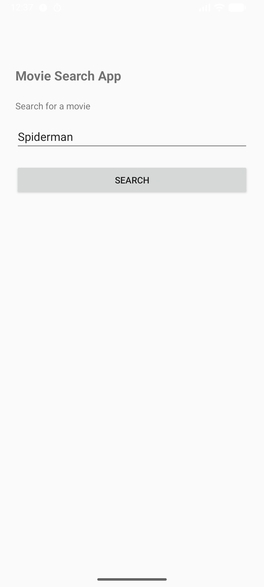
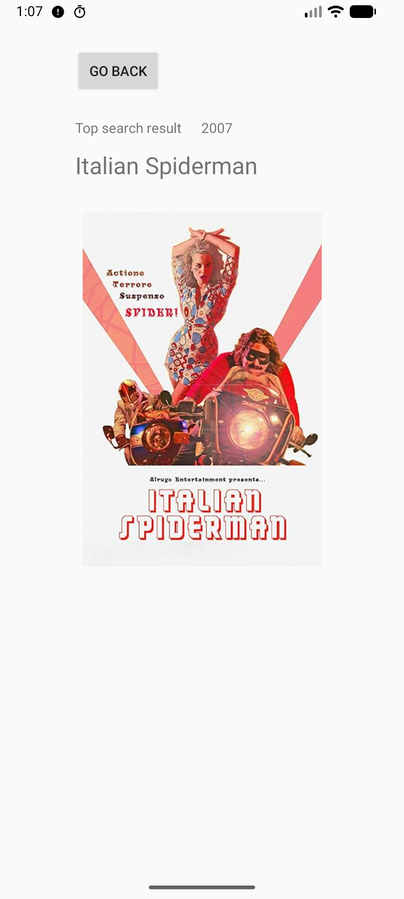
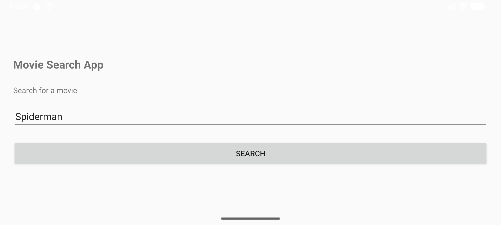
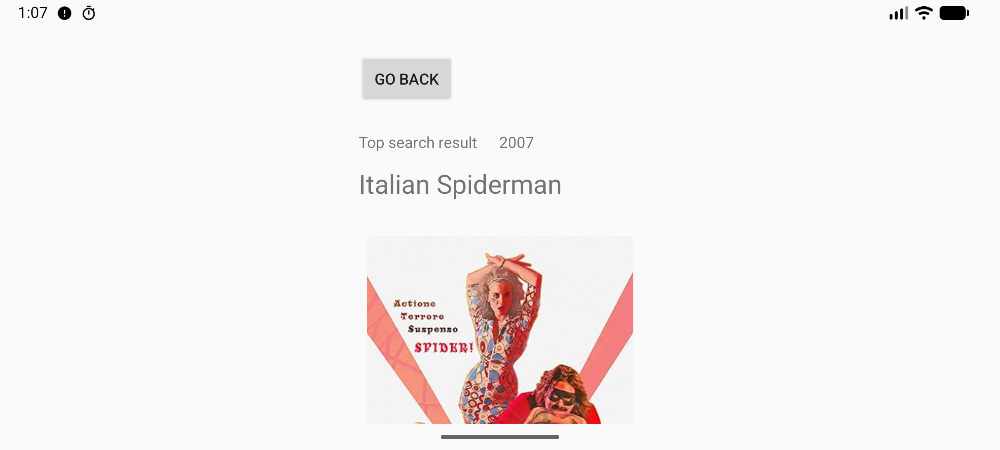
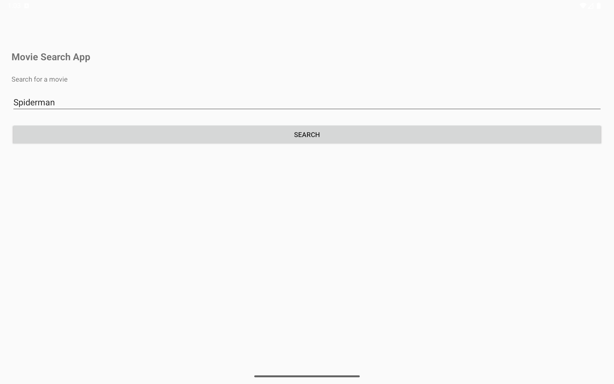
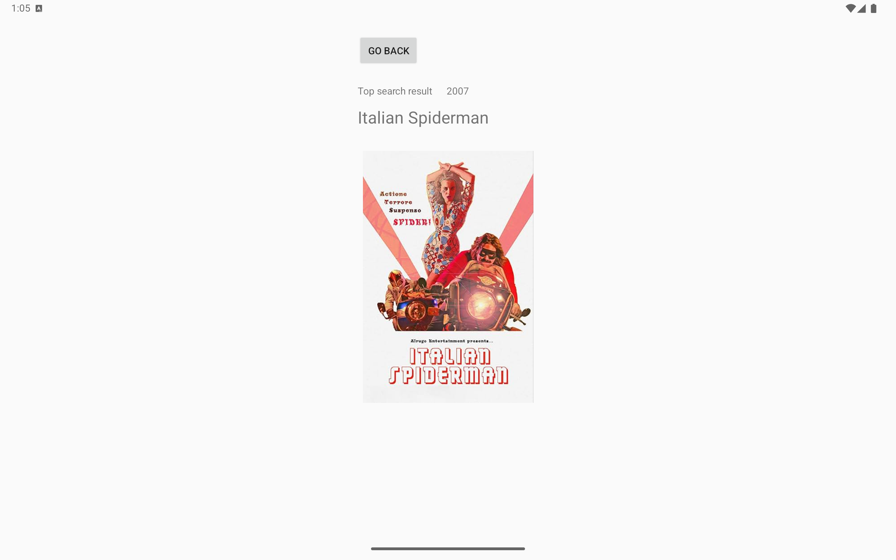

To run the application, please set an OMDB_API_KEY in local.properties. Example: OMDB_API_KEY=abcd1234

Open the solution in the Android Studio, verify Gradle settings, and run the application on the appropriate simulator (API 35 or higher).

The placeholder image and app icon were designed in Figma with no AI use.

Screenshots

Phone portrait: Search

Phone portrait: Result

Phone landscape: Search

Phone landscape: Result

Tablet: Search

Tablet: Result

